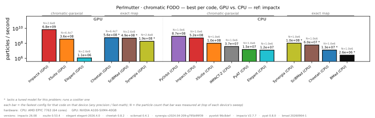
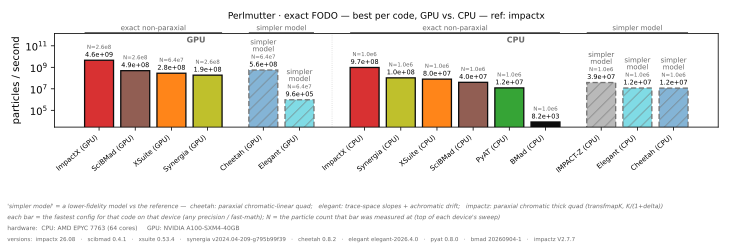
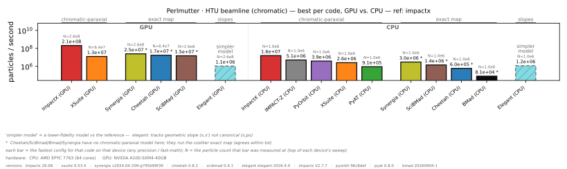
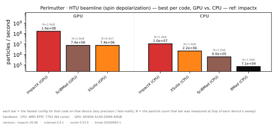
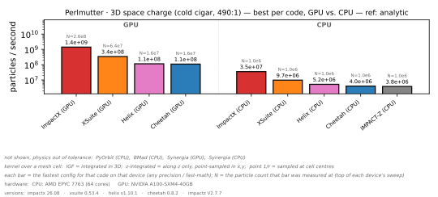
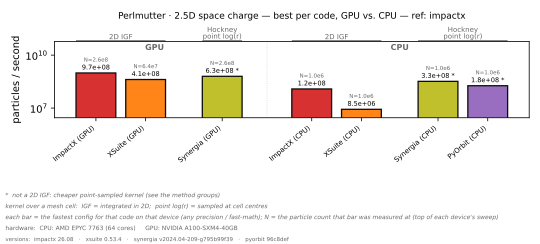

# ImpactX Benchmarks

Automated **correctness & performance** benchmarks of [ImpactX](https://github.com/BLAST-ImpactX/impactx)
against other community beam-dynamics codes. Each code is built the best-performing supported
way for the target CPU (`-march` builds where they beat prebuilt packages), tracks identical
physics scenarios, has its **physics validated**, and has its throughput (particles/second)
recorded.

**Published results come from [NERSC Perlmutter](https://docs.nersc.gov/systems/perlmutter/architecture/)**
under the rules below. The same harness also runs on a laptop or workstation with a smaller core
budget, for development. Results and plots are published to the
[`benchmarks`](../../tree/benchmarks) branch and embedded below.

## Benchmark rules

Every code gets the same hardware and may use it however is fastest:

| device | hardware | what a code may use |
|---|---|---|
| **CPU** | one 64-core **AMD EPYC 7763** socket of a CPU node | any split with **`MPI_ranks × threads ≤ 64`** |
| **GPU** | a GPU node's AMD EPYC 7763 socket + **one NVIDIA A100 (40 GB)** | one process on that GPU |

Jobs book whole nodes only because NERSC's job policies require it; each run uses only the
share above.

**CPU: one socket, used however is fastest.** Each code may spend the 64 cores any way its
design allows — all MPI ranks, all OpenMP/threads, or a mix. The budget is **physically pinned**:
every run is confined to the *same* 64 physical cores (`taskset` for the threaded process, one
slice of cores per rank for MPI), so OpenMP and MPI layouts compete on identical hardware rather
than whatever the OS scheduler hands out. For every `(code, scenario)` the harness *sweeps* the
layouts a code supports (e.g. `64r×1t`, `8r×8t`, `1r×64t`) and reports the **fastest** one; the
winning layout is printed under each bar. This keeps the comparison about implementation
quality, not who was allowed more cores — and it lets each code shine where its parallelism
works best (at 1M particles, ImpactX's chromatic FODO is fastest at `32r×2t` and its 3D space
charge at `8r×8t`; PyORBIT tracks fastest at `64r×1t` but its 3D space charge at `4r×1t`; Xsuite,
which only threads, mostly picks `1r×64t`). The CPU sweep goes up to 10⁶ particles.

**GPU: one A100.** Each code runs one process on one 40 GB A100, sweeping up to 10⁹ particles; a
code that runs out of the card's memory shows as `OOM` from that particle count on. The job
requests the 40 GB nodes and refuses to record on any other card, so every code gets the same
memory.

Codes are also built the best-performing supported way (`-march=znver3` for Perlmutter's Zen 3
CPUs, SIMD, the right solver), and physics is validated every run. Where a code supports them,
FP32 and fast-math builds run alongside the FP64 one. Local runs follow the same rules with a
smaller budget, set with `--ncores` (see *Run it locally*); Perlmutter's setup is in
[`machines/PERLMUTTER.md`](machines/PERLMUTTER.md).

## Latest results

<!-- These images live on the `benchmarks` branch and update on every publish from Perlmutter. -->







> GitHub's CDN caches raw images for a few minutes, so updates may lag slightly. Every plot,
> including one per particle count and the GPU-only comparison, is in
> [`plots/perlmutter`](../../tree/benchmarks/plots/perlmutter), and each run's exact input and
> launch command is in [`runs/perlmutter`](../../tree/benchmarks/runs/perlmutter).

**How to read the bars** (taller = faster, particles/second, on a log scale): GPU bars come first,
then CPU. Each bar is a code's **fastest** measured configuration on that device across the whole
particle sweep, so it may be an FP32 or fast-math build; the small `N=` label is the particle count
it was measured at.

| appearance | meaning |
|---|---|
| solid bar | physics **validated correct** vs the reference |
| value with **`*`** | shown, but the code runs a *non-tuned* model for this problem — either a costlier one (exact where chromatic suffices) or a cheaper/cruder one (a point-sampled kernel vs the integrated Green function in 2.5D); see the per-plot footnote |
| **dashed, hatched** bar + label | plotted but physics flagged: `simpler model` (a lower-fidelity model than the reference, named per code in the footnote), `physics ✗` (out of tolerance) or `unconv.` (out of tolerance, but its FP64 run is correct) |
| grey "unsupported" | the **code** cannot do this physics (e.g. no space charge); per-particle-count plots only |
| grey "not in harness" | the code can, but a run template hasn't been added **here** yet; per-particle-count plots only |
| grey "OOM" / "failed" | ran out of memory / errored; per-particle-count plots only |

## Codes & capabilities

Scenarios: **fodo_chromatic** (chromatic-paraxial FODO), **fodo_exact** (exact non-paraxial
FODO), **htu** (tracking), **htu_spin** (htu + Thomas-BMT spin), **spacecharge** (3D PIC),
**spacecharge_2p5d** (2.5D PIC). ✓ = implemented and physics-validated; ✓\* = shown but runs a
*non-tuned* model (see footnotes); `simpler model` = runs a lower-fidelity model than the reference
(drawn hatched); `physics ✗` = runs, but fails the physics check; ✗ = the code cannot do that physics.
The marks are the published Perlmutter results for FP64 on CPU at 10⁶ particles. GPU = runs on the
A100.

| code | fodo_chr¹ | fodo_exact² | htu³ | htu_spin⁵ | 3D SC⁴ | 2.5D SC⁴ | FP32⁶ | GPU | parallelism | install |
|------|:--:|:--:|:--:|:--:|:--:|:--:|:--:|:--:|------|------|
| [ImpactX](https://github.com/BLAST-ImpactX/impactx) | ✓ | ✓ | ✓ | ✓ | ✓ | ✓ | ✓ | ✓ | OpenMP+SIMD(+MPI) | source (CMake) |
| [Cheetah](https://github.com/desy-ml/cheetah) | ✓\* | `simpler model` | ✓\* | ✗ | ✓ | ✗ | ✓ | ✓ | torch / `torch.compile` | pip |
| [pyAT](https://github.com/atcollab/at) | ✓ | ✓ | ✓ | ✗ | ✗ | ✗ | ✗ | ✗ | OpenMP | source (native+OpenMP) |
| [PyORBIT3](https://github.com/PyORBIT-Collaboration/PyORBIT3) | ✓ | ✗ | ✓ | ✗ | `physics ✗` | ✓\* | ✗ | ✗ | MPI | source (Meson) |
| [Xsuite](https://github.com/xsuite/xsuite) | ✓ | ✓ | ✓ | ✓ | ✓ | ✓ | ✗ | ✓ | OpenMP | pip |
| [SciBmad.jl](https://github.com/bmad-sim/SciBmad.jl) | ✓\* | ✓ | ✓\* | ✓ | ✗ | ✗ | ✓ | ✓ | Julia threads | Julia pkg |
| [Bmad](https://github.com/bmad-sim/bmad-ecosystem) | ✓\* | ✓ | ✓\* | ✓ | `physics ✗` | ✗ | ✗ | ✗ | OpenMP | source (Fortran, libbmad) |
| [Synergia](https://github.com/fnalacceleratormodeling/synergia2) | ✓\* | ✓ | ✓\* | ✗ | `physics ✗` | ✓\* | ✗ | ✓ | MPI+OpenMP (Kokkos) | source (CMake) |
| [IMPACT-Z](https://github.com/impact-lbl/IMPACT-Z) | ✓ | `simpler model` | ✓ | ✗ | ✓ | ✗ | ✗ | ✗ | MPI | source (CMake, Fortran) |
| [HELIX](https://github.com/Accel-Toolkit/HELIX) | ✗ | ✗ | ✗ | ✗ | ✓ | ✗ | ✓ | ✓ | torch | source (pip) |
| [Elegant](https://github.com/rtsoliday/elegant) | ✓ | `simpler model` | `simpler model` | ✗ | ✗ | ✗ | ✗ | ✓ | MPI (Pelegant) | source (Make) |

The FODO and space-charge benchmarks split on the element/solver *model* so the comparison is
always like-for-like:
¹ **fodo_chr** — chromatic-paraxial FODO: `ChrQuad` + `ChrDrift` (`x' = px/(1+δ)`), the fast
workhorse model. ImpactX, pyAT, Xsuite, PyORBIT, IMPACT-Z and Elegant run a chromatic model
natively. Cheetah (no chromatic quad), SciBmad (only exact `MatrixKick`+exact drift), Bmad (only exact
`bmad_standard`) and Synergia (only exact libFF maps) run the costlier **exact** map as a stand-in →
**\***.
² **fodo_exact** — exact, non-paraxial FODO: `ExactQuad` + `ExactDrift` (nonlinear, sqrt-based):
ImpactX, pyAT (`ExactMultipolePass`), Xsuite (`drift-kick-drift-exact`), SciBmad (`MatrixKick` — a
symplectic integrator of the exact quad Hamiltonian — + `exact_drift`), Bmad (`symp_lie_ptc` quads)
and Synergia (libFF Yoshida quad + exact drift). Cheetah (whose quad is paraxial chromatic-linear even
with `drift_kick_drift`), IMPACT-Z (chromatic thick quad `transfmapK`) and Elegant (`KQUAD` in trace-space
slopes with an achromatic drift) have no exact quad; on this quad-dominated, hot beam they land about
2% below the exact result in `sigma_x` → **simpler model**. PyORBIT has no exact quad/drift (TEAPOT is
chromatic-paraxial) → ✗. Chromatic vs exact agree to O(angle²).
³ **htu** — the BELLA HTU beamline, chromatic-paraxial model. Cheetah, SciBmad, Bmad and Synergia run
the costlier exact map (no chromatic quad/drift) → **\***. Elegant tracks geometric slopes `(x, x')`
rather than canonical momenta, which differs by about 4% at the line's 2.5% energy spread →
**simpler model**.
⁵ **htu_spin** — the same HTU lattice with **Thomas-BMT spin tracking**; the beam starts fully
spin-aligned (+z) and the dispersive chicane differentially precesses spins → depolarization
(RMS spin spread, validated on sigma_sx/sy). Run by ImpactX (`SpinvMF`), Xsuite (`configure_spin`),
SciBmad (`Bunch(spin=true)` quaternions) and Bmad (`bmad_com%spin_tracking_on`); SciBmad and Bmad agree
with ImpactX to about 1% and Xsuite to 8–11% — depolarization is bend-model-sensitive, hence a 15%
tolerance. Cheetah, pyAT, PyORBIT, Synergia, IMPACT-Z and HELIX have no spin tracking (✗). Elegant's
spin tracking is experimental and gives zero spin spread here, so it is excluded (✗).
⁴ **space charge** — open-boundary FFT PIC, with plots grouped by how the kernel treats a mesh cell.
ImpactX, IMPACT-Z, Bmad, HELIX, Cheetah and Xsuite use a **full 3D integrated Green function (IGF)**;
Synergia's kernel is integrated along z only; PyORBIT samples **point 1/r** at cell centres. The 3D
benchmark is a single kick on a cold 490:1 (rest-frame) Gaussian bunch, checked against the **exact
closed-form field** (`scenarios/spacecharge/analytic.py`), so no code is the reference; a code that
misses it reads `physics ✗`. The 2.5D benchmark still compares to ImpactX on a beam where space charge
barely shows, so a ✓ there says less (issue #1). pyAT, SciBmad and Elegant have no self-consistent
(PIC) space charge. Cheetah, Bmad, IMPACT-Z and HELIX are 3D-only, and HELIX runs only the space-charge
benchmark, since its tracker is linear.

> **Xsuite FFT threading (important for SC perf).** The xfields PIC solve is FFT-bound (~77% of a
> 3D SC step). On CPU, xobjects only threads the FFT through **pyfftw**, which is **broken with
> xfields** — its `FFTCpu` binds the plan to one buffer (`assert data is self.data`) while xfields
> reuses one plan across arrays, so installing pyfftw raises `AssertionError`. Left at the default,
> xfields falls back to **single-threaded numpy/pocketfft**, making Xsuite SC several-fold slower
> than ImpactX (`fftw3_omp`) / PyORBIT. `workers=N` is **not** exposed by Xsuite/xobjects, but
> `Context.plan_FFT()` is — so we inject a **multithreaded `scipy.fft` plan (workers = OMP threads)**
> via a `ContextCpu` subclass (`scenarios/_xsuite_threaded_fft.py`), giving Xsuite a fair threaded
> FFT (~1.8× faster SC, bit-identical results) like the other codes.

> **SC kick splitting (solve count is matched).** The SC *field solve* dominates the cost, so a
> fair comparison requires each code to do the **same number of solves**. Source-verified (against
> the *built* versions) + counted: for the single-drift benchmark **all SC codes do exactly one SC
> solve per track, via a 1st-order asymmetric single kick** — apples-to-apples and consistent.
> Order within the element: **ImpactX** (ed88d69) and **PyORBIT** apply the SC kick at the element
> entrance (kick→drift); **Cheetah** and **Xsuite** apply the thin kick after the drift (drift→kick).
> None does a symmetric Strang split today. Watch: ImpactX is developing a symmetric Strang split
> ([impactx#846](https://github.com/BLAST-ImpactX/impactx/issues/846), not yet landed) whose
> kick-outer form would do **N+1** solves on *non-drift* elements — revisit when it ships or if SC
> is benchmarked on a non-drift element / N>1 slices.

⁶ **FP32** — single-precision variant, run **side-by-side** with FP64 in each scenario plot
(`<code>-cpu-sp` bars). ImpactX, Cheetah, SciBmad and HELIX (space charge only) have FP32;
pyAT, PyORBIT, Xsuite, Synergia, IMPACT-Z and Elegant run in FP64 only (Xsuite's kernels stay double
even given float32 input) and Bmad's `rp` is compile-fixed to double. ImpactX FP32 is a **separate compiled build** in its own `impactx-sp`
env (a clean build dir + `-DImpactX_PRECISION=SINGLE` sets fields *and* particles to single; a
pip install of SP would otherwise overwrite the DP one) and covers all scenarios incl. space
charge. FP32 results are validated against the FP64 ImpactX reference and dashed if outside tolerance.
On Perlmutter's CPUs at 10⁶ particles, FP32 runs 1.15–1.9× faster for ImpactX, 1.3–1.9× for Cheetah
and 2.8× for HELIX space charge, while SciBmad gains nothing (0.75–0.99×).

**Fair, matched models.** To make the comparison about implementation, not algorithm, every
code is pinned to the *same* physical model per scenario; where a model splits into a fast and an
exact variant, we run **two separate benchmarks** so it stays like-for-like:
* **FODO chromatic** — chromatic-paraxial thick quad (`k1 → k1/(1+δ)`) + chromatic-paraxial drift:
  ImpactX `ChrQuad`+`ChrDrift`, pyAT `QuadLinearPass`+`DriftPass`, Xsuite `mat-kick-mat`+`expanded`,
  PyORBIT `QuadTEAPOT`+`DriftTEAPOT`, IMPACT-Z chromatic thick quad (`transfmapK`) + exact drift,
  Elegant matrix `QUAD`+`DRIF` to third order. Cheetah/SciBmad/Bmad/Synergia lack a tuned chromatic
  model and run the exact map (marked `*`).
* **FODO exact** — exact nonlinear quad + exact non-paraxial drift: ImpactX `ExactQuad`+`ExactDrift`,
  pyAT `ExactMultipolePass`+`ExactDriftPass`, Xsuite `drift-kick-drift-exact`+`exact`, SciBmad
  `MatrixKick`+`exact_drift`, Bmad `bmad_standard` with `symp_lie_ptc` quads, Synergia libFF.
  Cheetah, IMPACT-Z and Elegant have no exact quad and run a simpler model (see ²). PyORBIT has no
  exact quad/drift → unsupported.
* **htu** — the BELLA HTU beamline (chromatic-paraxial quads + drifts; the few weak chicane
  bends use each code's thick bend). Cheetah/SciBmad/Bmad/Synergia run the costlier exact map
  (marked `*`); Elegant tracks slopes rather than canonical momenta (`simpler model`, see ³).
* **htu_spin** — the same HTU lattice with **Thomas-BMT spin tracking**: the beam starts fully
  spin-aligned (+z) and the dispersive chicane differentially precesses spins → depolarization
  (RMS spin spread). ImpactX, Xsuite (`configure_spin`), SciBmad (`Bunch(spin=true)`) and Bmad
  (`bmad_com%spin_tracking_on`) all run it; see ⁵ for the codes that don't.

> **Bmad** is driven by a small standalone Fortran driver linked directly to `libbmad`
> (no Tao/pytao) — see `codes/bmad/driver/` — and is exact-native like Cheetah/SciBmad.
* **space charge** — open-boundary FFT PIC, kept **separate** for 3D and 2.5D (a code without the
  matching solver is *unsupported* there). See footnote ⁴ for the kernel classes and the checks.

## Run it locally

Requires [pixi](https://pixi.sh). Local runs are for development; the published numbers come from
Perlmutter (see [`machines/PERLMUTTER.md`](machines/PERLMUTTER.md)).

```bash
# build the codes that compile from source (pip codes need no build); add --device cuda for GPU builds
pixi run build
pixi run build --device cuda

# run the full matrix on a 4-core budget (no other args = every code and scenario); --skip-build
# reuses the builds above, since without it bench re-runs every build task first
pixi run bench --ncores 4 --skip-build
pixi run bench --ncores 4 --skip-build --codes cheetah,pyat,xsuite --scenarios fodo_chromatic,fodo_exact,htu --runs 5
pixi run bench --device cuda --skip-build --codes impactx --nparts 100000,1000000   # on a local GPU

# validate physics & (re)generate plots
pixi run validate
pixi run plot            # plots/<scenario>{,_cpu,_gpu,_best,_best_liny}.svg (+ .pdf, .png)
pixi run plot --gpu      # GPU-only comparison, in plots/gpu/

# host/CPU/compiler/version metadata
pixi run metadata
```

Results are written to `results/<machine>.yaml`, where `<machine>` is `$BENCH_MACHINE_SLUG` or else
the hostname, and each cell's rendered input and launch command to `runs/<machine>/`. Pass
`--out plots/<machine>` to `plot` to match the published layout. Other `bench` options:
`--precision single` or `double` (default: both), `--nparts` to override the particle sweep,
`--resume` to skip cells already in the results file, and `--retry-failed` (with `--resume`) to
re-run cells stored as failed. Without `--ncores`, the budget is `$BENCH_NCORES`, or else every CPU
the OS reports, hyperthreads included. To commit results, plots and manifests to the `benchmarks`
branch, run `pixi run publish` for a dry run, then `pixi run publish --push`.

## How it works

```
benchmarks/      driver: registry, runner, affinity (core pinning), build, render, validate,
                 metadata, results, plotting, publish
scenarios/<s>/   physics params per scenario: fodo_chromatic and fodo_exact (sharing fodo/), htu,
                 htu_spin, spacecharge, spacecharge_2p5d; plus shared helpers (scenarios/_*.py)
codes/<c>/       one run template per scenario, <s>.<ext>.jinja (Python, Julia, Bmad, Elegant .lte,
                 IMPACT-Z .in), the code's build script, and any driver or patches it needs
machines/        Perlmutter job scripts, setup script and guide (PERLMUTTER.md)
pixi.toml        isolated environments per code (and per device, precision and fast-math build),
                 plus a driver environment
```

The [`benchmarks`](../../tree/benchmarks) branch holds what `publish` pushes:
`results/<machine>.yaml`, `plots/<machine>/`, `runs/<machine>/` (each cell's input and `run.sh`) and a
timestamped copy of each publish under `history/`.

For each `config × scenario × particle-count` the runner **sweeps the code's parallel layouts** on
CPU (`ranks × threads ≤ ncores`; see *Benchmark rules*); a GPU cell has a single layout, one process
on one GPU. It renders the template and launches it in the code's pixi environment: `mpirun -np
<ranks>` with each rank pinned to its own slice of cores and `OMP_NUM_THREADS=<threads>`, `taskset`
for a single threaded process (including `julia -t <threads>`), or a small driver for the
file-driven codes Elegant and IMPACT-Z, which builds the same command. The sweep is
**probe-then-time**: every layout runs once to rank them, then only the fastest runs `--runs` times
(default 5) and the minimum is reported, with its layout recorded as `cores` (e.g. `8r x 8t`). Each
run parses `Track: <ns>ns` (wall-clock) and `Validate: {json}` (beam observables), classifies
failures (`oom`/`failed`) and physics (`correct`/`incorrect`/`unconverged`), and saves
incrementally. `Code.core_configs()` only ever emits layouts with `ranks*threads ≤ ncores`, and the
runner asserts it before launching. Validation compares each result to the **ImpactX** result for
that scenario (each FODO variant has its own ImpactX reference), or to the exact answer where one
exists (3D space charge), with a sampling-aware tolerance (looser for the dispersive htu and the
space-charge scenarios). A run that does not report a validated observable fails that check.

**JIT fairness:** every run template does one untimed **warm-up** call before timing, so JIT
codes (Cheetah `torch.compile`, Xsuite cffi kernels, SciBmad/Julia) are measured at
steady state, never including compilation.

## Extending

* **New scenario** — add `scenarios/<name>/params.py` (a `PARAMS` dict; optional
  `analytic_observables()`), register it in `benchmarks/registry.py:SCENARIOS`, and add
  `codes/<code>/<name>.<ext>.jinja` for each code that supports it.
* **New code** — add a `[feature.<code>]` environment in `pixi.toml`, an entry in
  `benchmarks/registry.py:CODES` (capabilities, parallelism, launcher), configs in `CONFIGS`,
  a `codes/<code>/build.*` if it builds from source, and the run templates.

Missing `(code, scenario)` templates show up honestly as **"not in harness"** placeholders, so
coverage can grow incrementally.
